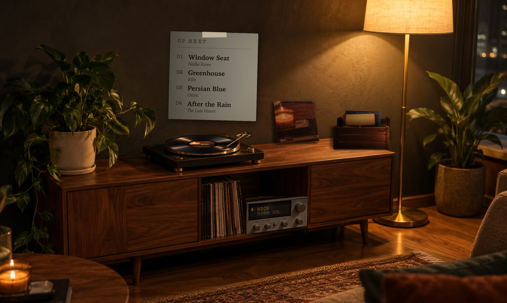

# 33rpm

An animated turntable on your Mac desktop that shows what's playing in YouTube Music (Chrome), live.
Personal project: no App Store, no accounts, no analytics. Everything stays on `127.0.0.1`.

```
music.youtube.com tab ──► Chrome extension (MV3) ──ws://127.0.0.1:33333──► 33rpm.app
   content.js               worker.js (WebSocket)    ◄── play/pause/next/prev ──
```



## Install (for everyone)

1. Download **[33rpm-1.2.1.dmg](https://github.com/rohan2025/33rpm/releases/latest)** from the latest release,
   drag **33rpm** into Applications and open it.
   It's a free hobby app and isn't notarized, so macOS will block it the first time:
   open **System Settings → Privacy & Security**, scroll down and click **Open Anyway**.
2. The **Setup Guide** opens on first launch (also in the menu bar). It has buttons to show the
   Chrome extension folder, open Chrome's extensions page and copy your pairing token.
3. In Chrome: `chrome://extensions` → **Developer mode** → **Load unpacked** → choose **33rpm Bridge**.
   Click its toolbar icon, paste the token, **Save**.
4. Play something on music.youtube.com.

## Building from source

`scripts/package.sh` builds the shareable DMG and a Chrome Web Store zip into `build/release/`.
Launch copy and images live in `launch/`.

## Requirements

- macOS 14 Sonoma or later (developed on macOS 26 Tahoe)
- Xcode 15+ installed (full Xcode, not just Command Line Tools)
- Google Chrome

## Build and run the app

```bash
scripts/build_app.sh release --run
```

This builds `build/33rpm.app`, ad-hoc signs it and opens it. For a quicker dev loop:

```bash
cd App && swift run
```

You can also open `App/Package.swift` in Xcode and press Run.

33rpm is a menu bar app (no Dock icon): look for the record icon in the menu bar.

On first launch the app creates a pairing token at
`~/Library/Application Support/33rpm/token`. Use **Copy Pairing Token** in the menu bar menu to copy it.

### Menu bar

- Now playing, plus Play/Pause, Next, Previous
- **Show Turntable** (⌘T): show/hide the desktop scene
- **Scene**, **Size** (Small 480pt, Medium 800pt, Full screen), **Display** (All Displays by default, or pin to one)
- **Launch at Login** (only works from `build/33rpm.app`, not `swift run`)
- **Copy Pairing Token**, **Show Debug Window**, **Quit**

The scene sits at desktop level: above the wallpaper, below all windows and desktop icons, on every Space,
and clicks pass through it. It won't be visible on a display while a full-screen app occupies it.

## Load the Chrome extension (unpacked)

1. Open `chrome://extensions` in Chrome.
2. Turn on **Developer mode** (top right).
3. Click **Load unpacked** and pick the `extension/` folder in this repo.
4. Click the 33rpm Bridge toolbar icon (pin it from the puzzle-piece menu), paste the pairing token, click **Save**.
   The status should turn green: **Connected to 33rpm**.
5. Open or refresh `https://music.youtube.com` and play something.

After editing extension files, click the reload icon on the extension's card in `chrome://extensions`.
Already-open YouTube Music tabs get the new content script automatically.

## How it works

- **content.js** polls `navigator.mediaSession` once per second (falling back to the player bar DOM) for
  title, artist, album, artwork, play state, position and duration. It sends on any change, plus a heartbeat
  every 5s while playing. Artwork URLs are rewritten to 1200×1200.
- **worker.js** holds the WebSocket to the app, authenticates with the token, reconnects with backoff, and
  routes commands back to the tab by clicking the player bar buttons.
- **The app** listens on `127.0.0.1:33333` only, rejects any WebSocket whose `Origin` isn't
  `chrome-extension://…`, and drops connections that don't send the right token within 5 seconds.
  When the socket closes (Chrome quit, tab closed) it goes idle.

## Troubleshooting

- **"Not connected"**: is the app running? Check the app window says *Listening on 127.0.0.1:33333*.
- **"Token rejected"**: copy the token again from the app and save it in the extension.
- **"Server failed: Port 33333 …"**: another process has the port. `lsof -i :33333` to find it.
- **Nothing updates**: refresh the YouTube Music tab, then check the extension's service worker console
  (`chrome://extensions` → 33rpm Bridge → *service worker*).
- **New token**: delete `~/Library/Application Support/33rpm/token` and relaunch the app.

## Scenes and your artwork

Each scene is a folder in `Scenes/` (`Evening`, `RainyWindow`, `Minimal`) holding a `scene.json` and PNG layers.
All three ship with photoreal art generated in ChatGPT: one room photo per scene (the Rainy and Minimal rooms are
edits of the Evening photo, so the console and turntable sit in exactly the same place) plus a top-down record,
tonearm and crate front shared by all three. The originals are kept in each scene's `_sources/` folder (not bundled).
Any slot without a PNG is drawn as a simple placeholder. **Menu bar → Open Scenes Folder** opens the current one.
For ready-made AI image prompts and the recommended "one painted room" approach, see
[Scenes/ART_PROMPTS.md](Scenes/ART_PROMPTS.md).

The app picks up changes live (no rebuild): save a PNG or edit `scene.json` and the desktop updates in a moment.
Files are looked up in this order, first match wins:

1. `~/Library/Application Support/33rpm/Scenes/<Scene>/` (personal overrides)
2. `Scenes/<Scene>/` in this repo
3. the copy bundled into `33rpm.app` at build time

### Slots

| File | Where it lives | Notes |
|---|---|---|
| `background.png` | scene | Full room: wall, floor, lamp. Covers the whole canvas (1500×1000). |
| `plant.png` | scene | Transparent PNG. |
| `console.png` | scene | Walnut record console, drawn in perspective. |
| `sleeve_shadow.png` | scene | Optional extra shadow behind the leaning sleeve (one is cast automatically). |
| `crate.png` | scene | Front panel of the crate only (transparent above it): played sleeves stand behind it and poke out the top. |
| `deck_base.png` | deck | Turntable top, **drawn straight down from above**. |
| `platter.png` | deck | Top-down, square canvas, circle filling it. |
| `record.png` | deck | Top-down vinyl, square. The album art label is added on top automatically. |
| `tonearm.png` | deck | Top-down, arm pointing **straight down**, pivot near the top (see `anchor`). |
| `lid.png` | deck | Smoked glass, top-down, semi-transparent. |
| `default_label.png` | — | Optional. Centre label shown when nothing is playing. |
| `default_sleeve.png` | — | Optional. Sleeve on the wall when nothing is playing. |
| — | scene | `up_next` entry places the Up Next card (`frame`, `rotation`); no PNG, it's drawn as paper. |
| `lamp_glow.png` | scene | Optional soft light pool over the lamp; flickers gently while music plays. |
| `ambient.mp4` | scene | Optional short looping video (rain, candle, city lights), muted. Placed by the `video` slot. |

The `sleeve` entry in `layers` has no PNG: it shows the current album art, leaning by `rotation` degrees.
`dust` and `rain` entries are particle effects drawn by the app (no PNG), placed by their `frame`.

**Scene** layers are placed flat on the canvas. **Deck** layers are drawn top-down and the app tilts the
whole deck into perspective (`deck.tilt`), so the record and tonearm rotate correctly in 3D.
Use transparent PNGs at about 2× the frame size for sharpness.

### scene.json

- `canvas`: design size; the scene scales to fill the window.
- `edgeFade`: soft fade into the wallpaper at the edges, in canvas points (Small/Medium only; 0 = hard edges).
- `layers`: scene layers in back-to-front order, `frame: [x, y, width, height]` with a top-left origin.
  `{ "slot": "deck" }` marks where the turntable goes in that order.
- `deck`: `center` and `size` of the deck top in canvas points, `tilt` in degrees (0 = seen from above),
  `perspective` (bigger = flatter), and its own `layers` in deck coordinates.
- `controls`: optional `center` [x, y] and `scale` for the hover playback controls (default: just in front of the deck).
- `focus`: canvas point kept in view when Full size crops the scene to a screen of a different shape.
- Optional per layer: `anchor: [x, y]` (pivot as a fraction of the frame), `opacity`, `hidden`,
  `blend` (`screen`, `add`, `softLight`, `overlay`, `multiply`), `flicker` (lamp_glow, 0–1),
  `amount` (dust/rain density), `file` (video file name, default `ambient.mp4`).
- `record`: `rpm`, `labelDiameter` (fraction of the record), `sheenOpacity`, `spinUpSeconds`, `spinDownSeconds`.
- `crate`: `sleeveSize` (sleeve width as a fraction of the crate), `peek` (how much sticks out the top),
  `browseLift` (how far a hovered sleeve rises).
- `tonearm`: `restAngle`, `startAngle` (outer groove), `endAngle` (run-out groove), `moveSeconds`.
  Angles are degrees clockwise from the PNG's straight-down orientation.

To check a layout without looking at the desktop, render it to a PNG
(`--demo-history 8` fills the crate with fake sleeves, `--browse 2` pulls one out):

```bash
build/33rpm.app/Contents/MacOS/33rpm --snapshot ~/Desktop/scene.png --playing --progress 0.5 --demo-history 8
```

## Scenes and ambience

Pick a scene from **menu bar → Scene**: **Evening** (warm lamp, dust in the light), **Rainy Window**
(cool room, rain on the window) or **Minimal** (deck, sleeve and crate on a shelf). Each scene folder can have
its own PNGs and `ambient.mp4`; anything missing falls back to that scene's placeholder.

Ambient motion (dust, flicker, rain, video) runs only while music is playing. Everything freezes while the
display sleeps, the screen is locked, or the scene is fully covered (for example by a full-screen app), and the
app itself stays at about 0% CPU: the animation runs in macOS's compositor.

## Crate history

When a song leaves the deck (next track, or Chrome closes) after playing at least 3 seconds, its sleeve slides
off the wall into the crate. The crate keeps the last 20 and remembers them across restarts
(`~/Library/Application Support/33rpm/history.json` plus artwork in `History/`; delete both to empty the crate).

Hover over the crate to flip through: move left (newest) to right (oldest), or scroll. **Click** the raised
sleeve to play that song in your YouTube Music tab (opened in Chrome if the extension isn't connected).
Sleeves saved before version 0.2 of the extension don't know their video, so clicking them opens a search instead.
A replayed song goes back into the crate at the front, not twice.

## Controls on the desktop

- **The receiver** in the console's open shelf is the remote: its amber display shows the song and artist
  (long titles scroll), and its three left knobs are ⏮ ⏯ ⏭ (a soft amber ring shows which one you're on;
  the display confirms each press). Clicking the turntable also plays or pauses.
  The receiver is painted into each room photo by `scripts/composite_receiver.py`; its live display and knobs
  are placed by the `receiver` block in scene.json.
- **Up Next card** on the wall lists the next 4 songs in your YouTube Music queue; click one to jump to it.
- **The crate**: hover to flip through, click a sleeve to play it again.

Clicks only stop passing through to the desktop while the pointer is over the turntable, the receiver's knobs,
the card or the crate.

## Settings

**Menu bar → Settings…** (⌘,): record speed (12–45 rpm; real is 33⅓, "Relaxed 22" is calmer on screen),
show/hide the hover controls, the Up Next card and the ambient effects, plus scene, size and launch at login.

## Layout

```
extension/          Chrome extension (manifest, content script, worker, options popup)
App/                Swift package for the macOS app
Scenes/             Scene folders: scene.json + your PNG layers
scripts/            build_app.sh
```

## License

MIT, see [LICENSE](LICENSE). The room art, record, tonearm, crate and sleeve images were generated for this
project with ChatGPT.
